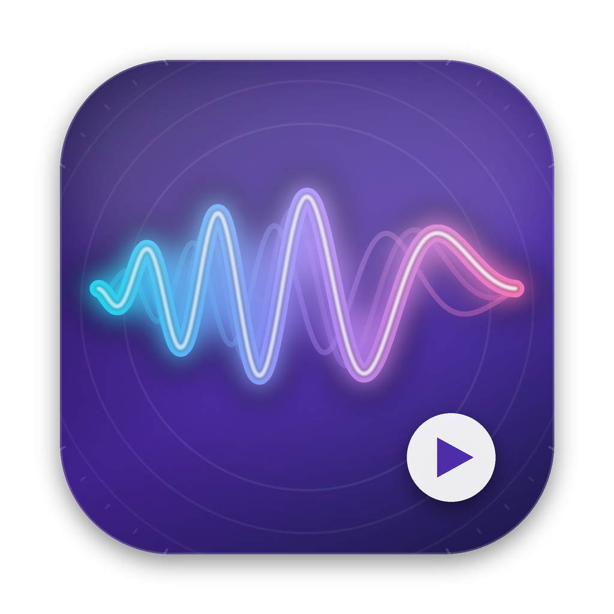

<p align="center">
  
</p>

<h1 align="center">SlowFlowX</h1>

<p align="center">
  A native macOS practice studio for musicians.<br>
  Paste a YouTube link → see the chords and lyrics → slow it down without changing the pitch.
</p>

---

SlowFlowX downloads the audio of a song and detects its chords on the GPU with **Metal**. It shows time-synced lyrics with the chords above each line, and you can practise any section at any speed, as a loop, transposed to your key.

## Features

### Import
- **YouTube import**: paste a link and SlowFlowX downloads the audio with [`yt-dlp`](https://github.com/yt-dlp/yt-dlp). If `ffmpeg` is installed, the audio is converted to M4A.
- **Library**: every song you import stays in the sidebar, together with its analysis and lyrics.

### Chord analysis (Metal + Accelerate)
- The audio is turned into a spectrum with **vDSP** (8192-point FFT, 93 ms hop).
- The **`fold_chroma` Metal compute kernel** turns the spectrum into a 12-bin chromagram.
- The **`score_chords` Metal compute kernel** compares every frame against 48 chord templates (maj, min, 7, m7) that take harmonics into account.
- An **HMM / Viterbi** pass smooths the result so chord changes are stable and musical.
- **Key** (Krumhansl–Schmuckler) and **tempo** (onset autocorrelation) are estimated as well.

### Chords
- A large **current / next chord** display, including how long until the next change at your current speed.
- **Piano or guitar diagrams**. Switch in the Chords panel or in Settings.
  - Guitar uses open shapes where they exist and E- or A-shape barre chords for everything else.
  - Root notes are highlighted.
- **Chords in this song**: a strip showing every chord the song uses, with its shape.
- A **chord grid** you can click to jump to a chord. Right-click a chord to loop it.

### Stem separation
- **Split any song into stems**: vocals, drums, bass, guitar, piano and other.
  - **Demucs (AI, recommended)**: Meta AI Research's open-source separator runs locally and uses the GPU (MPS) on Apple Silicon. You can choose between a 6-stem, a 4-stem or a fine-tuned 4-stem model in Settings › Stems.
  - **Built-in (quick)**: no extra software is needed. It separates the stereo centre and splits sustained sounds from drum hits, using a **Metal median-filter kernel**. You get 4 stems at lower quality.
- **Stem mixer** under the waveform: mute, solo or set the volume of each stem while playing.
  - All stems stay sample-locked, and speed, transpose and loops still apply.
  - Right-click a stem for **Solo only** or **Everything except** (a karaoke or play-along backing track).
- **Better transcriptions**: each part is transcribed from its isolated stem when one exists (vocal melody → vocals, bass → bass, lead and rhythm → guitar). On-device lyric transcription uses the vocals stem.

### Tab & notes (riffs and melodies)
- **Melody transcription**: pick the **vocal melody**, a **lead guitar riff**, the **rhythm guitar** or the **bass line**, and SlowFlowX transcribes it.
  - The **`melody_salience` Metal compute kernel** scores how strong every possible pitch is in each 12 ms frame. It sums the harmonics and suppresses octave errors.
  - A **Viterbi pitch tracker** detects where the part is playing and keeps glides and vibrato smooth.
  - Semitone **note segmentation** turns the pitch line into separate notes.
  - **Accurate note lengths**: an attack detector splits repeated notes (e.g. chugging riffs) into separate hits and snaps each note to its attack. For guitar and bass, notes end when the pitch dies away rather than when it disappears completely.
  - **Tempo and beat position** are found for every part, so bar lines and the 16th grid line up with the music.
- **Rhythm guitar**: strums are detected from attacks and labelled **↓ down / ↑ up**. Down falls on the beat, up between beats. If a fair share of strums land on in-between 16ths, the pattern is treated as 16th-note strumming. Each strum shows the chord shape from the chord analysis, in the tab and in the piano roll.
- **Rhythm notation** under the tab: stems, flags, dots, and beams grouped per beat.
- **Grid snapping**: show notes as played (Off), or snapped to 1/8 or 1/16 notes. Exports use the same setting.
- **Tempo controls**: ½× / 2× / ±1 BPM when the tempo guess is off. **Beat Here** moves the grid so a beat falls at the playhead.
- **Guitar / bass tab** that scrolls with the music:
  - Frets are chosen by an optimiser that keeps hand movement small (standard EADGBE tuning, or EADG for bass).
  - Notes outside the instrument's range are moved by an octave and marked 8va/8vb.
  - Chord names and beat and bar lines are shown above the tab.
- **Piano roll** with a keyboard whose keys light up as each note plays, plus note names on the bars.
- A **current / next notes** display, with the current lyric line underneath.
- Drag to scrub and click to jump. Speed, looping and transpose all apply (transposing re-fingers the tab).
- **Export MIDI** (open it in GarageBand, Logic or MuseScore to see sheet music; the first beat is aligned to the bar), or **copy / save a plain-text tab** with a rhythm line and down/up strum markers.
- Transcription is automatic and approximate. It works best when the part stands out in the mix.

### Lyrics
- **Synced lyrics** from [LRCLIB](https://lrclib.net), with the chords shown above each line. The current line is highlighted and auto-scrolls; click a line to jump to it.
- **Manual search** by artist and title, for when the automatic match misses.
- **On-device transcription** with Apple's speech recogniser, as a fallback. It is approximate on music.

### Practice
- **Slow down without changing pitch**: 25 – 150 % speed via `AVAudioUnitTimePitch`, with 50/75/100 % presets.
- **Transpose** ±12 semitones. The chords, key and diagrams follow.
- **Zoomable waveform** drawn with Metal:
  - Scroll or swipe to move through the song. Zoom with ⌘-scroll, a pinch, or the +/− buttons.
  - **Drag to select a section**. It becomes the A–B practice loop. Dragging past the edge scrolls the view.
  - A full-song **overview** above the waveform shows where you are and can be dragged.
  - A time ruler, and a chord lane that zooms with the waveform.
  - The view follows the playhead while playing.
- **A–B looping**, plus "Play Section" and "Zoom to Section".
- A **live spectrum analyser** (Metal) fed from an audio-engine tap.

### Export
- **Export WAV** of the whole song or the selected section, with the audio you choose:
  - the **original mix**,
  - **selected stems mixed into one WAV**, optionally at your mixer volumes (e.g. a backing track without vocals),
  - or **one WAV per stem** written into a folder.
  - If the song has no stems yet, you can start separation right from the export dialog. The stems show up there when it finishes.
- Optionally with your current speed and transpose applied (pitch preserved). Useful as a practice track for your phone.
- 16- or 24-bit. Rendering runs offline, faster than real time.

### Look & feel
- **Adaptive layout**: the header, waveform and stem mixer always keep their full height, and the Chords & Lyrics or Tab & Notes panel fills the rest. On small windows the workspace scrolls instead of squeezing, and the transport bar stays pinned to the bottom.
- Native SwiftUI with **7 themes**: Midnight, Aurora, Ember, Ocean, Graphite, Paper (light) and Sakura (light).
- A custom app icon.

## Requirements

- macOS 14 Sonoma or later (Apple Silicon or Intel)
- Xcode 15+ **or** the Command Line Tools (Swift 5.9+)
- `yt-dlp`, plus `ffmpeg` (recommended):

```bash
brew install yt-dlp ffmpeg
```

- Optional, for high-quality stem separation: [Demucs](https://github.com/facebookresearch/demucs)

```bash
brew install uv
uv tool install --python 3.12 demucs --with "torch==2.8.*" --with "torchaudio==2.8.*"
```

  Use Python 3.12, because some dependencies have no builds for the newest Python yet. Pin torch and torchaudio to 2.8, because torchaudio 2.9+ saves audio through TorchCodec, which breaks Demucs' output. With pipx instead: `pipx install --python python3.12 demucs && pipx inject demucs "torch==2.8.*" "torchaudio==2.8.*"`.

## Build & run

```bash
git clone https://github.com/lydianb79/SlowFlowX.git
cd SlowFlowX
./Scripts/build_app.sh                    # → build/SlowFlowX.app (release)
open build/SlowFlowX.app

./Scripts/build_app.sh release --install  # also copies it to /Applications
```

To work in Xcode, open `Package.swift` and run the **SlowFlowX** scheme. Use the `.app` from the build script for speech transcription, because that feature needs the permission string in `Info.plist`.

The Metal shaders are compiled at runtime from `MetalShaders.swift`. You don't need the separate Metal toolchain or a `.metallib` build step.

## Keyboard & mouse

| Action | Shortcut |
|---|---|
| Play / pause | Space, or ⌘P |
| Back / forward 5 s | ← / →, or ⌘← / ⌘→ |
| Slower / faster / normal speed | ⌘[ / ⌘] / ⌘0 |
| Transpose down / up | ⌥⌘↓ / ⌥⌘↑ |
| Loop start / end / clear | ⇧⌘A / ⇧⌘B / ⇧⌘L |
| Export WAV | ⌘E |
| Chords & Lyrics / Tab & Notes view | ⌘1 / ⌘2 |
| Move through the waveform | scroll or swipe |
| Zoom the waveform | ⌘-scroll or pinch |
| Select a section to practise | drag on the waveform |
| Jump to a position | click the waveform, a chord or a lyric line |

## Project layout

```
Sources/SlowFlowX/
  App/        SlowFlowXApp (scene, menus, key monitor), AppModel (state & workflows)
  Audio/      PlaybackEngine (multi-stem AVAudioEngine + TimePitch), SpectrumTap (live FFT),
              AudioExporter (offline WAV render of the mix or any stems)
  Analysis/   AudioLoader (decode/resample), ChordAnalyzer (STFT → chroma → Viterbi, key, tempo),
              MelodyAnalyzer (harmonic salience → pitch tracking → notes, strums),
              OnsetDetector (attacks, beat position)
  Models/     Song/chord/lyrics models, Melody (notes, tab fingering, MIDI & text-tab export)
  Metal/      MetalShaders (MSL source), MetalContext (pipelines + GPU compute),
              MetalViews (waveform & spectrum renderers, mouse/trackpad handling)
  Services/   YouTubeDownloader (yt-dlp), LyricsService (LRCLIB + Speech), ProcessRunner,
              StemSeparator (Demucs runner + built-in Metal-accelerated separator)
  Theme/      Theme definitions + ThemeStore
  Views/      Sidebar, import bar, workspace & waveform, chords panel, chord diagrams,
              lyrics, melody tab & piano roll, transport, export sheet, settings
Resources/    Info.plist, AppIcon.icns, AppIcon.iconset, AppIcon-1024.png
Scripts/      build_app.sh
```

Your library (audio, stems and analysis) is stored in `~/Library/Application Support/SlowFlowX/`.

## Troubleshooting

- **Downloads fail**: YouTube has probably changed something. Run `brew upgrade yt-dlp`.
- **"yt-dlp was not found"**: install it with Homebrew, then click *Re-check* on the start screen or in Settings › Tools.
- **No lyrics found**: use the 🔍 button in the Lyrics panel to search by exact artist and title, or transcribe from the audio.
- **Bars or note lengths look shifted**: use ½× / 2× if the tempo is off. Then pause on a clear downbeat and press **Beat Here**. Parts transcribed with an older version show an **Update Transcription** button.
- **Demucs won't install** (Rust / PyO3 / "Python version is newer than … supported"): install with Python 3.12 as shown under Requirements.
- **Demucs fails or is slow**: make sure `demucs` runs in Terminal (`demucs --help`). A TorchCodec error means torchaudio is too new, so reinstall with the 2.8 pins. The first run downloads the model. If the GPU fails, SlowFlowX retries on the CPU, which is slower. The built-in separator always works.
- **Messy tab / notes**: separate the stems first, then use **Transcribe from Stem**. try another part (Vocal, Lead or Bass). Transcription follows whichever part is loudest in its range, so busy mixes produce stray notes. Slowing down doesn't affect the transcription, but it makes checking by ear much easier.
- **Wrong chords**: automatic recognition is an estimate. It is very good for practice charts, but dense mixes, heavy distortion or jazz voicings will cause errors. Use the chord grid together with your ears.

## Credits

- Audio download: [yt-dlp](https://github.com/yt-dlp/yt-dlp) and [FFmpeg](https://ffmpeg.org)
- Synced lyrics: [LRCLIB](https://lrclib.net)
- AI stem separation: [Demucs](https://github.com/facebookresearch/demucs) (Meta AI Research)
- Time-stretching, speech recognition and DSP: Apple AVFoundation, Speech and Accelerate

## Notice

Only download content that you have the right to use, and respect YouTube's Terms of Service. Lyrics are fetched at runtime from third-party services and are not part of this repository.
